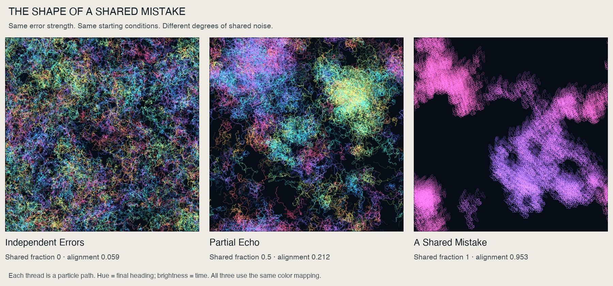
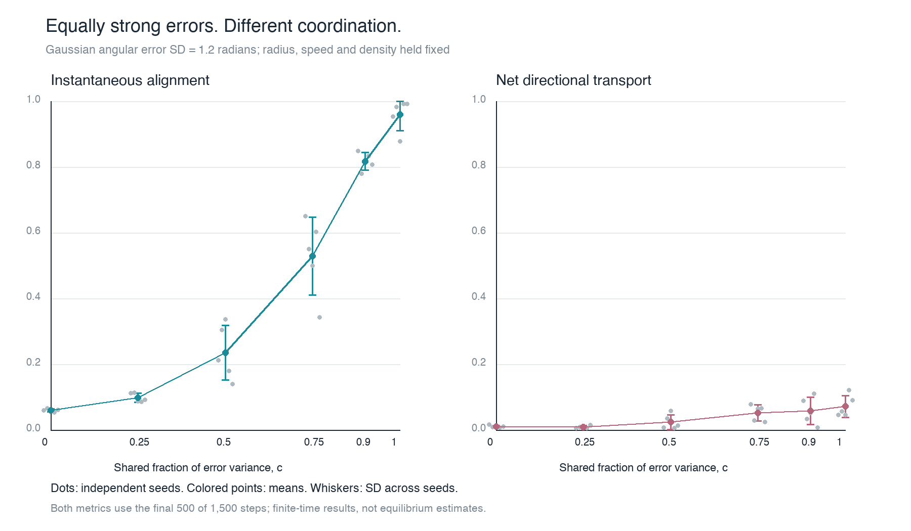

# The Shape of a Shared Mistake

**How does sharing equally strong directional errors change collective motion?**

An independent computational visualization project exploring correlated noise in a local-alignment model. The three artworks show independent, partially shared, and fully shared perturbations while individual error strength, density, speed, sensing radius, and starting conditions remain fixed.



## The experiment

Each of 1,100 particles turns toward the circular mean heading of its neighbors, receives a Gaussian angular perturbation, and advances at a fixed speed. Positions wrap across a periodic square.

The perturbation is

```text
delta_i(t) = sigma * [sqrt(c) * Z_common(t) + sqrt(1-c) * Z_i(t)]
```

The standard normal draws are independent except for the explicitly shared draw. Every particle has error variance `sigma²` for all values of `c`. The parameter `c` controls correlation between particles' errors.

- 1,100 particles; periodic domain side 25; sensing radius 1.
- Speed 0.18 length units per step; angular-error SD 1.2 radians.
- Six shared fractions: 0, 0.25, 0.5, 0.75, 0.9, and 1.
- Five independent seeds per fraction: 30 simulations.
- 1,500 steps per simulation; final 500 steps used for summaries.
- Initial positions, headings, and underlying random draws match across conditions at each seed.

## What the artwork encodes

Each thread traces one particle through its final 90 recorded positions. Its entire trajectory receives the color of its **final heading**; brightness increases toward the end of the path. This color does not describe instantaneous direction at every earlier segment. A small halo is derived from the path raster for presentation. All images use the same mapping and full-domain framing.

The displayed conditions and seed were selected in advance: `c = 0, 0.5, 1`, seed `20261011`.

## Results

Two measurements distinguish agreement from persistent motion:

- **Alignment P:** time average of the magnitude of the mean particle unit-heading vector.
- **Directional transport Q:** magnitude of the time average of that vector.

Both range from zero to one; `Q ≤ P`. A group can agree at each moment while repeatedly changing its collective direction.

| Shared fraction c | Mean alignment P | Mean transport Q |
|---:|---:|---:|
| 0 | 0.060 | 0.010 |
| 0.25 | 0.098 | 0.009 |
| 0.5 | 0.234 | 0.023 |
| 0.75 | 0.529 | 0.052 |
| 0.9 | 0.817 | 0.058 |
| 1 | 0.959 | 0.071 |

Values average five seeds per condition. Individual runs and temporal-window checks are in [results.csv](results.csv).



These are finite-time simulation results for the stated parameters. They do not establish equilibrium, a transition threshold, or a biological mechanism in a particular species. Here, “mistake” means a perturbation from the local mean heading; no externally correct target direction is defined.

## Run it

Use Python 3.11 or newer. The pinned dependencies match the environment used for the supplied results.

```bash
python -m venv .venv
source .venv/bin/activate
python -m pip install -r requirements.txt

# Check geometry, circular means, noise statistics, and reproducibility.
python model.py

# Run all 30 simulations; cached runs allow resuming.
python experiment.py --seeds 5

# Generate review-size images and the scientific results plot.
python render.py --size 1800

# Optional: render the competition print-size images.
python render.py --size 8700
```

On Windows, activate the environment with `.venv\Scripts\activate`.

Running the experiment creates NPZ caches beside the scripts. If you change the model implementation, remove or move those caches before rerunning. The default cache check compares configurations, not source-code revisions.

The repository contains lightweight JPEG artwork copies. The native 8,700-pixel PNG exports and generated NPZ caches are excluded from ordinary Git tracking; both can be recreated with the commands above.

## Files

- `model.py`: particle dynamics and independent validation checks.
- `experiment.py`: matched-seed experiment, CSV results, and metadata.
- `render.py`: trajectory artwork, contact sheet, and measurement chart.
- `results.csv`: measurements for the 30 completed simulations.
- `experiment_details.json`: configuration, aggregate results, and limitations.
- `render_details.json`: visual mapping and original export metadata.
- `project_notes.txt`: detailed methods, interpretation, and checks.
- `01_independent_errors.jpg`, `02_partial_echo.jpg`, `03_a_shared_mistake.jpg`: lightweight artwork copies.

## Model credit and assistance

The local-alignment rule builds on Vicsek, T., Czirók, A., Ben-Jacob, E., Cohen, I., and Shochet, O. (1995), *Novel Type of Phase Transition in a System of Self-Driven Particles*, Physical Review Letters 75, 1226–1229. [DOI: 10.1103/PhysRevLett.75.1226](https://doi.org/10.1103/PhysRevLett.75.1226).

This implementation uses correlated Gaussian angular noise and advances positions with newly updated headings. It is an independent experiment and visualization built on an established model.

The project was developed for a UT Austin master's student in Data Science who selected noise as its scientific focus. Experiment design, code, analysis, image rendering, and documentation were developed with Codex assistance. The images are direct renderings of simulated trajectories.
